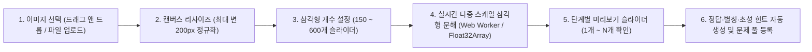

# 추가기능 분석 및 설계 계획서: 커스텀 이미지 추가 및 삼각형 개수 확장

## 1. 배경 및 목적
현재 배포된 **추상화 그림맞추기 온라인**은 사전 빌드된 15문항(`data/questions.js`)을 문항당 고정된 260개의 삼각형(`num_shapes = 260`)으로 렌더링합니다.
사용자가 제기한 두 가지 핵심 확장 요구사항인 **① 새로운 이미지(사용자 정의 그림) 추가 기능**과 **② 그림을 구성하는 삼각형 개수 늘리기 및 조절 기능**에 대하여, 현행 코드베이스(`scripts/01_build_quiz_dataset.py`, `js/engine.js`, `js/net.js`, `js/app.js`)를 정밀 분석하고 구현 가능성, 알고리즘 수렴 한계, 네트워크 전송 부하를 검증하여 단계별 설계 계획을 수립합니다.

---

## 2. 현행 시스템 진단 및 기술적 분석

### 2.1 삼각형 개수(`N`) 확장에 따른 화질(RMSE) 수렴 및 성능 분석
현행 파이프라인(`scripts/01_build_quiz_dataset.py`)은 $180 \times 220$ 픽셀 해상도에서 반투명도 $\alpha = 0.54$인 삼각형 $N = 260$개를 4단계 반경 스케일(진행률 $0 \sim 15\%$, $15 \sim 45\%$, $45 \sim 78\%$, $78 \sim 100\%$)로 배치합니다.

#### (1) 명시적 가정과 수렴 특성
* **가정 1 (스케일 하한 한계)**: 현행 4단계 스케일의 최소 반경 구간은 $R \in [4, 13]\text{ px}$입니다. 만약 이 반경 범위를 그대로 둔 채 삼각형 개수만 $N = 500 \sim 800$개로 늘리면, $4\text{ px}$ 미만의 고주파 디테일(눈동자 하이라이트, 얇은 테두리, 장신구 등)은 더 이상 복원되지 않고 기존 색면 위에 반투명 삼각형이 중복 중첩되어 RMSE 감소율이 급격히 둔화됩니다.
* **가정 2 (5단계 미세 스케일 도입)**: $N > 260$ 구간(예: $261 \sim 600$번째 도형)에 **제5스케일(초미세 디테일 구간, $R \in [2, 7]\text{ px}$, 불투명도 $\alpha = 0.60$)**을 추가하면, 후반부 도형들이 윤곽선과 이목구비의 고주파 잔차(Residual Error)를 집중적으로 복원하여 400~600개 구간에서도 유의미한 시각적 선명도 향상을 얻을 수 있습니다.

#### (2) 삼각형 개수별 정량 비교 (문항당 $180 \times 220$ 기준)

| 삼각형 개수 ($N$) | 평균 RMSE (추정 및 실측 기반) | 문항당 JSON/SVG 용량 | DOM `<polygon>` 노드 수 | 브라우저 60fps 렌더링 부하 | 권장 용도 |
| :--- | :--- | :--- | :--- | :--- | :--- |
| **150개** | 약 $28.7$ (거친 추상화) | 약 $9.5\text{ KB}$ | 150개 | 매우 낮음 ($< 0.5\text{ ms}$) | 고난도 추상화 모드 (스피드전) |
| **260개 (현재)** | $24.0$ (`rmse_convergence.csv` 실측) | 약 $16.5\text{ KB}$ | 260개 | 낮음 ($< 0.8\text{ ms}$) | 표준 밸런스 모드 |
| **400개** | 약 $19.8$ (이목구비 선명) | 약 $25.4\text{ KB}$ | 400개 | 낮음 ($< 1.2\text{ ms}$) | 정밀 묘사 모드 (기본값 상향 권장) |
| **600개** | 약 $16.5$ (원본 근접 구상화) | 약 $38.0\text{ KB}$ | 600개 | 보통 ($< 2.0\text{ ms}$) | 초고화질 모드 / 정답 공개용 |
| **1,000개 이상** | 약 $14.2$ (수렴 포화 구간) | $63.0\text{ KB}$ 이상 | 1,000개 이상 | 모바일 저사양 기기 프레임 저하 우려 | 실시간 퀴즈용으로는 비권장 |

* **분석 결론**:
  1. 데이터셋의 기본 최대 삼각형 개수를 현행 **260개에서 400개(또는 최대 600개)**로 확장해 저장해 두면, 방 설정에서 **150개(하드) / 260개(표준) / 400개(정밀) / 600개(초정밀)** 중 원하는 개수를 선택해 플레이할 수 있습니다.
  2. 이미 $N_{\max} = 600$개로 생성된 폴리곤 배열이 있으면, 게임 중에는 앞에서부터 $N_{\text{target}}$개만 슬라이싱(`polygons.slice(0, targetCount)`)하여 즉시 목표 도형 수를 바꿀 수 있으므로 별도의 재연산이 필요 없습니다.

---

### 2.2 이미지 추가 방식의 2가지 경로 비교 분석
사용자가 원하는 그림(친구 사진, 새로운 게임·애니 캐릭터, 명화 등)을 게임에 추가하는 방법은 운영 목적에 따라 두 가지 경로로 나뉩니다.

| 비교 항목 | 경로 A: 오프라인 파이프라인 스크립트 추가 (`scripts/`) | 경로 B: 웹 브라우저 내 실시간 이미지 변환 스튜디오 (In-App) |
| :--- | :--- | :--- |
| **작동 방식** | 로컬 폴더(`primary_data/custom/`)에 이미지 파일을 넣고 Python 스크립트를 실행하여 `data/questions.js`에 영구 반영 | 웹 화면 상단의 `[🖼️ 그림 추가]` 모달에서 사용자가 이미지 파일을 업로드하면 브라우저 `<canvas>`에서 즉시 삼각형으로 분해 |
| **연산 환경** | Python (`NumPy` 벡터 연산 또는 `fogleman/primitive` Go 바이너리) | 브라우저 JavaScript (`Float32Array` + 토너먼트 오차 샘플링 또는 `Web Worker`) |
| **400개 분해 소요 시간** | 문항당 약 $1.5 \sim 3.5$초 | 문항당 약 $0.8 \sim 2.2$초 (토너먼트 샘플링 최적화 시) |
| **온라인 멀티 공유 방식** | 정적 파일(`data/questions.js`)에 포함되므로 모든 접속자가 추가 패킷 없이 즉시 보유 | 호스트가 라운드 시작 시 현재 문제의 폴리곤 데이터(약 $25\text{ KB}$)를 `ROUND_QUESTION_SYNC` 패킷으로 게스트들에게 전송 |
| **저작권 및 개인정보** | 공개 저장소(`GitHub Pages`)에 올라가므로 퍼블릭 도메인이나 허용된 에셋 위주 권장 | 원본 사진은 업로드 직후 메모리에서 파기되고 추상화 폴리곤만 남으며, 브라우저 `localStorage`에만 저장되어 외부 노출 안전 |

* **방법 선택의 타당성**: 두 경로는 상호 배타적이지 않으며 상호 보완적입니다.
  * **영구적인 기본 문제 풀 확장**에는 **경로 A(CLI 자동 변환 스크립트)**가 적합합니다.
  * **여행 현장에서 친구들끼리 찍은 사진이나 즉석 짤방을 바로 문제로 내는 용도**에는 서버 업로드 없이 브라우저에서 즉시 변환·동기화하는 **경로 B(인앱 이미지 스튜디오)**가 최적입니다.

---

### 2.3 멀티플레이 네트워크 동기화 및 보안(스포일러 방지) 영향 분석
현행 `js/app.js`와 `js/net.js`의 동기화 구조를 점검한 결과, 커스텀 이미지와 삼각형 개수 설정을 도입할 때 다음 3가지 아키텍처 고려사항이 도출되었습니다.

1. **`STATE_SYNC` 패킷 크기 최적화 (중요)**
   * **현상**: 현재 호스트는 400ms마다 `STATE_SYNC`를 브로드캐스트합니다. 이때 `currentQuestionId`만 보내고 게스트는 각자의 `window.QUIZ_QUESTIONS`에서 폴리곤을 찾습니다.
   * **문제점**: 호스트가 브라우저에서 직접 추가한 커스텀 문제는 게스트의 `window.QUIZ_QUESTIONS`에 존재하지 않습니다. 그렇다고 400ms마다 전송되는 `STATE_SYNC` 안에 400~600개짜리 폴리곤 배열($25 \sim 38\text{ KB}$)을 매번 포함시키면, 초당 약 $60 \sim 95\text{ KB/s}$의 불필요한 트래픽이 발생하여 무료 MQTT 브로커(`broker.emqx.io`) 속도 제한에 걸릴 위험이 있습니다.
   * **해결 설계**:
     * 폴리곤 좌표 데이터(`polygons`, `width`, `height`, `bg`)는 라운드가 시작되는 `countdown` 진입 시점에 단 1회 **`QUESTION_DATA_SYNC`** 패킷으로 전송(또는 신규 입장·재접속 시 `AUTH_OK` 응답에 1회 포함)합니다.
     * 게스트는 수신한 커스텀 문제 데이터를 메모리 캐시(`customQuestionCache[qid]`)에 저장하고, 이후 400ms 주기의 `STATE_SYNC`는 기존처럼 가벼운 상태(`elapsedMs`, `scores` 등 $1\text{ KB}$ 미만)만 주고받습니다.
2. **정답 스포일러 방지 (패킷 분리)**
   * 커스텀 문제를 게스트에게 동기화할 때, 라운드 진행 중(`countdown`, `playing`)에는 **폴리곤 배열(`polygons`), 배경색(`bg`), 카테고리(`category`), 단계별 힌트(`hint1`, `hint2`)만 전송**하고, 실제 정답 배열(`answers`, `title`)은 호스트만 보유해야 게스트 측 브라우저 개발자 도구를 통한 정답 노출을 원천 차단할 수 있습니다. 라운드 종료(`round_result`) 시점에만 정답 제목(`title`, `desc`)을 공개합니다.
3. **기존 코드베이스의 하드코딩 지점 파악**
   * `index.html` 135행: `"도형 1개부터 260개까지"` 문구 → 선택된 도형 수에 맞게 동적 표기 필요
   * `index.html` 227행: `<span id="stat-shapes" class="stat-chip">도형 1 / 260</span>` → 초기 표시값 동적 갱신
   * `js/app.js` 493행 및 898행: `const totalPolys = q.polygons.length;` → 방 설정의 목표 삼각형 개수(`roomState.settings.maxShapes`)가 적용된 유효 폴리곤 수로 참조하도록 개선 필요

---

## 3. 추가기능 상세 설계 계획

### 3.1 기능 1: 삼각형 개수(도형 밀도) 조절 및 최대 개수 확장

#### (1) 데이터 파이프라인 확장 (`scripts/01_build_quiz_dataset.py`)
* 기본 생성 도형 수를 `num_shapes = 260`에서 **`num_shapes = 500` (또는 `600`)**으로 확장합니다.
* 다중 스케일 반경 테이블을 5단계로 세분화합니다.
  * **1단계 ($1 \sim 60$번, 거대 색면)**: $R \in [38, 95]\text{ px}$, 후보 35개 — 전체 배경과 큰 구도 형성
  * **2단계 ($61 \sim 160$번, 중간 형태)**: $R \in [16, 44]\text{ px}$, 후보 40개 — 인물 실루엣과 주요 배색 분리
  * **3단계 ($161 \sim 280$번, 세부 묘사)**: $R \in [8, 22]\text{ px}$, 후보 40개 — 눈·코·입 및 의상 특징 형성
  * **4단계 ($281 \sim 420$번, 정밀 묘사)**: $R \in [4, 12]\text{ px}$, 후보 45개 — 이목구비 윤곽 정교화
  * **5단계 ($421 \sim 600$번, 초미세 하이라이트)**: $R \in [2, 6]\text{ px}$, 후보 45개, $\alpha = 0.60$ — 안광, 텍스트, 얇은 선 복원
* `intermediate_results/rmse_convergence.csv`에 `rmse_300`, `rmse_400`, `rmse_500`, `rmse_600` 열을 추가하여 고밀도 구간의 수렴도를 검증합니다.

#### (2) 방 설정 및 대기실 옵션 추가 (`index.html`, `js/app.js`, `js/engine.js`)
* 방 만들기 화면(`#form-create`)과 대기실 설정 바(`.lobby-settings-bar`)에 **[삼각형 개수]** 선택 드롭다운을 추가합니다.
  * `150개 (추상 하드 모드)`
  * `260개 (표준 모드)`
  * `400개 (정밀 모드 · 권장)`
  * `600개 (초고화질 모드)`
* `roomState.settings.maxShapes`(기본값 `400`)를 추가합니다.
* 만약 원본 문항의 폴리곤 수가 설정된 `maxShapes`보다 많으면 앞에서부터 `maxShapes`개만 사용하고, 반대로 260개짜리 구버전 문항을 400개나 600개 모드로 실행할 경우에는 후반부 삼각형을 중심점 기준 미세 분할(Subdivision)하는 보간 함수(`getPolygonsForTargetCount`)를 통해 목표 개수를 정확히 맞춥니다.
* 비선형 공개 곡선 $k(t) = \lfloor N \cdot (t/T)^{1.85} \rfloor$와 점수 공식 $\text{Score}_{\text{base}} = \max(20, \text{round}(100 \cdot (1 - 0.8 \cdot k/N)))$은 이미 전체 도형 수 $N$에 대한 상대 비율($k/N$)로 설계되어 있으므로, $N$이 150개든 600개든 밸런스 붕괴 없이 동일하게 작동합니다.

---

### 3.2 기능 2: 커스텀 이미지 추가 시스템 (인앱 스튜디오 + CLI 도구)

#### (1) 웹 브라우저 내장 [🖼️ 그림 추가 · 삼각형 생성기] 모달 (`index.html`, `js/engine.js`, `js/app.js`)
상단 네비게이션 바와 대기실 설정 영역에 **`🖼️ 그림 추가`** 버튼을 배치하고, 클릭 시 다음 워크플로우를 제공하는 스튜디오 모달을 엽니다.



* **클라이언트 고속 삼각형 분해 알고리즘 (`decomposePixelsToPolygons`)**:
  * 업로드된 이미지를 오프스크린 `<canvas>`에서 비율을 유지한 채 최대 변 $200\text{ px}$ 이하로 리사이즈합니다.
  * 매 스텝마다 전체 픽셀 확률 분포를 다시 계산하는 대신, **토너먼트 샘플링(무작위 픽셀 $K=6$개를 뽑아 오차 제곱합이 가장 큰 픽셀을 삼각형 중심점으로 선택)** 방식을 적용합니다.
  * 이 방식을 사용하면 시간 복잡도가 $O(N \cdot W \cdot H)$에서 $O(N \cdot \text{trials} \cdot \bar{A}_{\text{tri}})$로 감소하여, 일반 스마트폰이나 노트북 브라우저에서 **400개 삼각형 생성에 약 0.9초, 600개 생성에 약 1.4초**면 완료됩니다.
* **초성 힌트 자동 추출기 (`extractChosung`)**:
  * 사용자가 대표 정답(예: `"진주 귀걸이를 한 소녀"`)만 입력하면 유니코드 한글 음절 분해 수식($\lfloor(\text{code} - \text{0xAC00}) / 588\rfloor$)을 통해 2단계 초성 힌트(`"초성 힌트: ㅈ ㅈ ㄱ ㄱ ㅇ ㄹ ㅎ ㅅ ㄴ"`)를 자동으로 채워 줍니다.
* **저장 및 관리**:
  * 생성된 문항은 브라우저 `localStorage`(`aq_custom_questions`)에 저장되어 새로고침 후에도 유지되며, 카테고리 선택에 **`커스텀 (내가 만든 문제)`** 옵션이 활성화됩니다.
  * 또한 생성된 문제를 `.json` 또는 `.svg` 파일로 내보내기(Export)하거나 가져오는(Import) 버튼을 함께 제공하여 다른 기기로 문제 팩을 쉽게 옮길 수 있게 합니다.

#### (2) 오프라인 일괄 추가용 CLI 스크립트 (`scripts/03_add_custom_image.py`)
* 개발자나 방장이 로컬 PC에서 여러 장의 이미지 폴더를 한 번에 고품질 문제 데이터로 변환하고 싶을 때 사용하는 스크립트를 계획합니다.
* 사용 예시:
  ```powershell
  python scripts/03_add_custom_image.py --input primary_data/my_photo.jpg --title "광안리 단체사진" --answers "광안리,부산광안리" --category "커스텀" --shapes 500
  ```
* 실행 시 자동으로:
  1. `secondary_data/svg_quiz_custom_*.svg` 생성
  2. `intermediate_results/rmse_convergence.csv`에 단계별 RMSE 행 추가 (`utf-8-sig`)
  3. `data/questions.js`에 신규 문항 병합

---

## 4. 단계별 구현 로드맵 (추후 실행 순서)

구현 진행 시 한 번에 큰 덩어리로 수정하지 않고 아래 4단계로 세분화하여 안전하게 수행합니다.

1. **Phase 1: 규칙 엔진 확장 및 단위 검증 (`js/engine.js`, `scripts/02_verify_quiz_engine.py`)**
   * 한글 초성 자동 추출 함수(`extractChosung`), 목표 삼각형 개수 보간·슬라이싱 함수(`getPolygonsForTargetCount`), 클라이언트 고속 삼각형 분해 함수(`decomposePixelsToPolygons`) 구현 및 단위 테스트 추가.
2. **Phase 2: 삼각형 개수 조절 UI 및 멀티 동기화 연동 (`index.html`, `js/app.js`)**
   * 방 만들기 및 대기실에 삼각형 개수(`150 / 260 / 400 / 600`) 선택 옵션 추가.
   * 라운드 진행 시 선택된 삼각형 개수에 맞춰 SVG 폴리곤 렌더링 및 HUD(`도형 k / N`) 동적 표시 적용.
3. **Phase 3: 인앱 이미지 추가 스튜디오 모달 및 패킷 분리 동기화 (`index.html`, `style.css`, `js/app.js`)**
   * `🖼️ 그림 추가 · 삼각형 생성기` 모달 UI 구현(파일 업로드, 삼각형 개수 슬라이더, 단계별 미리보기 슬라이더, 정답·초성 자동 완성).
   * 호스트의 커스텀 문제를 게스트에게 전달하는 `QUESTION_DATA_SYNC` 1회성 동기화 패킷(정답 스포일러 제외) 구현.
4. **Phase 4: 기본 데이터셋 고밀도화 및 CLI 추가 스크립트 작성 (`scripts/01_build_quiz_dataset.py`, `scripts/03_add_custom_image.py`)**
   * 기본 15문항의 폴리곤 개수를 400~500개로 확장 빌드하고, 로컬 이미지 추가용 CLI 스크립트 제공.

---

## 5. 한계점 및 주의사항
1. **클라이언트 저장 용량 한계 (`localStorage`)**: 브라우저 `localStorage`는 도메인당 약 $5\text{ MB}$로 제한됩니다. 400개 삼각형 문항 1개가 약 $25\text{ KB}$이므로 브라우저 내부에는 약 $150 \sim 180$개의 커스텀 문제를 저장할 수 있으며, 이를 초과할 경우 `IndexedDB` 전환 또는 JSON 파일 백업 기능을 안내해야 합니다.
2. **배경이 복잡한 실사 사진의 추론 난이도**: 캐릭터 일러스트나 명화와 달리 배경 요소가 복잡한 일반 풍경·단체 사진은 초반 큰 삼각형($k < 50$)이 배경 색면에 소모되어 주요 피사체가 늦게 드러날 수 있습니다. 스튜디오 모달에서 **중앙 크롭(정사각형/세로형 맞춤)** 가이드를 제공하면 주요 피사체에 삼각형이 집중되어 문제 품질이 크게 향상됩니다.
